<!--
  ╔════════════════════════════════════════════════════════════════╗
  ║  README DE PERFIL — FÁBIO MATHEUS // SISTEMA DEV                ║
  ║                                                                ║
  ║  ✏️  O QUE EDITAR (procure por "EDITE" neste arquivo):          ║
  ║   1. Usuário: usei "fabio-tech-dev". Se o seu for outro,      ║
  ║      substitua TODAS as ocorrências (Ctrl+H / Ctrl+F).         ║
  ║   2. Projetos: atualize os nomes dos projetos e seus links.       ║
  ║                                                                ║
  ║  O repositório precisa se chamar igual ao seu username         ║
  ║  (ex.: fabio-tech-dev/fabio-tech-dev) e ser público.           ║
  ╚════════════════════════════════════════════════════════════════╝
-->

<!-- 1. CABEÇALHO -->

ADS &bull; UNA BOM DESPACHO

<!-- 2. INICIALIZAÇÃO DO PERFIL -->

 

<!-- 3. TERMINAL -->


  

 

<!-- 4. STATUS ATUAL -->



<!-- 5. TECNOLOGIAS -->


   
    
   
    
   
    
   
    

<!-- 6. EM ANDAMENTO -->



<!-- 7. ATIVIDADE NO GITHUB -->
<!-- ✏️ EDITE: se o seu nome de usuário não for "fabio-tech-dev", troque nas URLs abaixo -->



  
  

  

<!-- 8. CONTRIBUIÇÕES -->


<!-- gerado pelo workflow .github/workflows/activity-signal.yml (branch activity-output) -->
<!-- ✏️ EDITE: troque "fabio-tech-dev/fabio-tech-dev" se o seu username for outro -->

  

<!-- 9. PROJETOS -->
<!--
  ✏️ EDITE OS LINKS: cada card abre o repositório e o botão LINK abre o site.
     Os cards abaixo apontam para os projetos publicados.
-->


<!-- PROJETO EM DESTAQUE -->

  <a href="https://github.com/fabio-tech-dev/Portifolio-Fabio"></a> 
  

<!-- PROJETOS -->

  <a href="https://github.com/fabio-tech-dev/AssetPulse"></a>
  <a href="https://github.com/fabio-tech-dev/Smash-Fire"></a>
  <a href="https://github.com/fabio-tech-dev/Barbearia-014"></a> 
  
  
  

<!-- MAIS PROJETOS -->

  <a href="https://github.com/fabio-tech-dev/FilipeCel"></a>
  <a href="https://github.com/fabio-tech-dev/Academia-Corpo-e-Movimento"></a>
  <a href="https://github.com/fabio-tech-dev/OREIA-TECH-SITE-OFICIAL"></a> 
  
  
  

<!-- 10. MATRIZ DE CONTRIBUIÇÕES (gerada pelo workflow .github/workflows/snake.yml) -->
<!-- ✏️ EDITE: troque "fabio-tech-dev/fabio-tech-dev" se o seu username for outro -->


  <picture>
    <source media="(prefers-color-scheme: dark)" srcset="https://raw.githubusercontent.com/fabio-tech-dev/fabio-tech-dev/output/github-snake-dark.svg" />
    <source media="(prefers-color-scheme: light)" srcset="https://raw.githubusercontent.com/fabio-tech-dev/fabio-tech-dev/output/github-snake.svg" />
    
  </picture>

<!-- 11. CONTATO -->


  
  

  

<!-- 12. RODAPÉ -->

